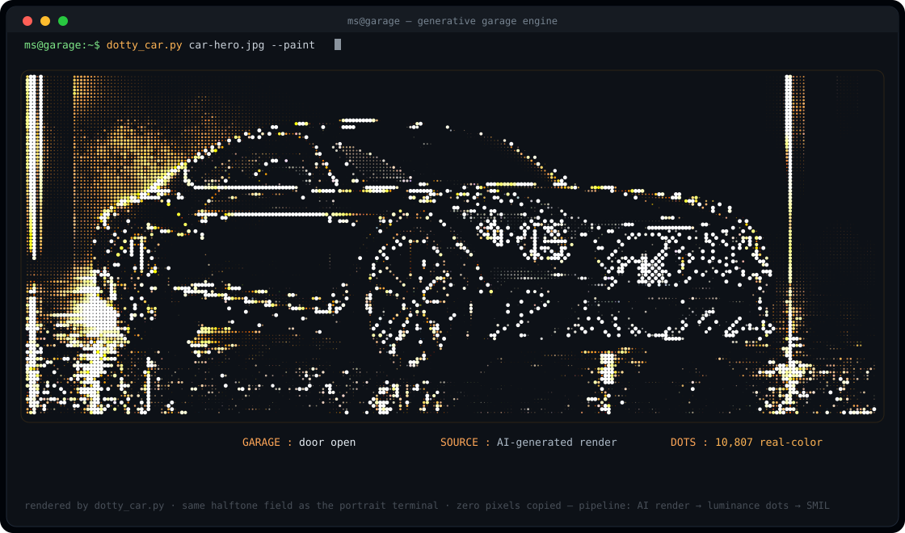
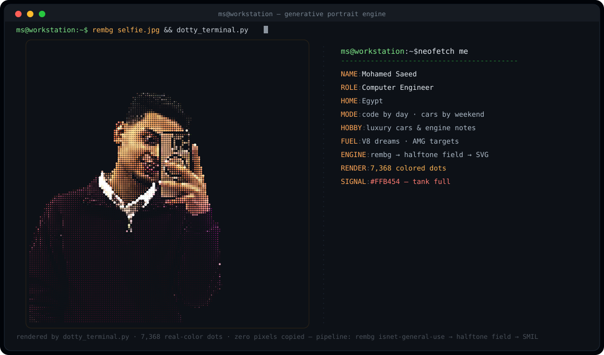

🏁 the opening shot was <b>generated by AI</b>, then <b>painted dot by dot by the terminal</b> — a luminance field of 10,807 real colors over the studio render. the machine before the man: scroll down.

  

  
  
  

  

<h2 align="center">🖥️ System Diagnostics</h2>

⚡ the terminal above is a <b>live SMIL animation</b>, not a screenshot — one Python pass types the command, cuts the background off the photo with an AI matting model, paints my face as <b>7,368 real-color dots</b> band by band, then prints the stats. Loops forever, inside GitHub markdown, zero JavaScript.

Computer engineer by training, petrolhead by necessity. I build systems that have to work — and I judge other systems by how their exhaust note sounds at 6,000 rpm.

<h2 align="center">🧬 How this README was generated</h2>

<b>pipeline:</b> selfie → <b>AI background removal</b> (<code>rembg · isnet-general-use</code>) → bust crop → tone curve → halftone dot field → animated neofetch SVG. The car terminal: <b>AI-generated</b> render → luminance dot field (dark studio = no dots) → full-bleed garage-door sweep. <b>zero manual drawing</b> — every dot is computed by <a href="generative/matting.py">matting.py</a>, <a href="generative/dotty_terminal.py">dotty_terminal.py</a> and <a href="generative/dotty_car.py">dotty_car.py</a>.

 

🏁 <b>م. محمد سعيد</b> — مهندس حاسبات · عاشق عربيات · 🇪🇬

